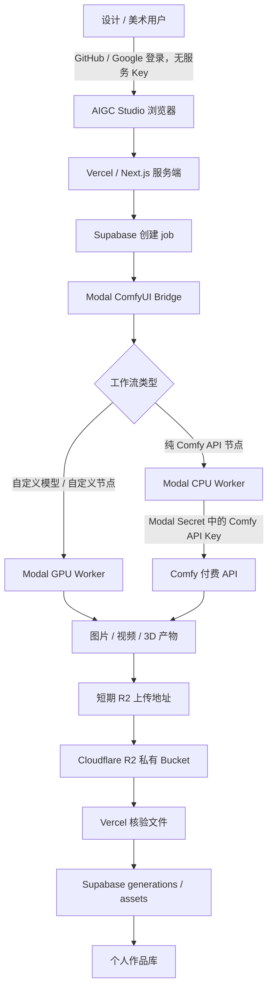

# Claude Review Brief：AIGC Studio × Modal ComfyUI Bridge × R2

> 本文是给 Claude / GLM / Codex 做架构和实现审阅的材料。请严格区分“当前已实现”和“目标方案”；不要把目标方案当作已上线功能。

## 1. 一句话目标

部署同学用本地 ComfyUI + `comfyui_modal_bridge` 部署和维护一套 Modal ComfyUI 运行环境；设计 / 美术用户只操作 AIGC Studio 网站。用户提交预设后，Modal 在 GPU 或 CPU 上执行已经验证过的工作流，作品直接进入 Cloudflare R2，再显示在个人作品库。

普通用户没有 Modal、Comfy、R2、OpenRouter、fal 的任何 Key。

## 2. 已确认的产品决定

### 2.1 后端优先顺序

| 创作类型 | 第一选择 | 第二选择 | 第三选择 |
|---|---|---|---|
| 图片 | Modal + ComfyUI | OpenRouter | fal.ai |
| 视频 | Modal + ComfyUI | OpenRouter Video | fal.ai |
| 3D | Modal + ComfyUI | fal.ai | — |

- “优先”是部署默认和人工切换顺序，**不是静默自动 fallback**。服务报错、额度不足或配置缺失时，要明确失败，不能偷偷换到另一家计费服务。
- OpenRouter 当前有正式图片和异步视频接口；没有应作为项目依赖的正式 3D 生成接口。

### 2.2 两种使用场景必须共存

1. **部署 / 测试模式**：部署同学在本地 ComfyUI 使用 Bridge，同步节点和模型，结果仍可回到本地画板，方便测试工作流。
2. **网站交付模式**：AIGC Studio 使用同一个已经部署好的 Bridge，但结果必须进入 R2，不应回到部署机，也不应依赖某台设计电脑在线。

## 3. 当前仓库状态（事实）

### 已有能力

- `aigc_jobs → aigc_generations → aigc_assets`：任务、结果、资产归属完整。
- Cloudflare R2 是作品完成的前提；作品库从 R2 签名读取。
- Vercel Cron 能兜底检查未完成任务。
- 当前图片 provider 已有 Modal、OpenRouter、fal、自建 ComfyUI 四条路径；OpenRouter 当前只接图片，3D / 视频当前走 fal。
- 当前工作流模板在 `lib/workflows/templates/`，格式是可提交给 ComfyUI 的 API JSON，并由 `lib/workflows/image-registry.ts` 写入 prompt、尺寸、seed。
- `materializeCompletedJob` 已能处理 provider 返回的 `r2Key`，这是后续 Bridge 直接交付 R2 的可复用基础。

### 尚未满足目标的地方

1. `lib/engines/modal-image.ts` 使用的是旧协议：`MODAL_ENDPOINT_BASE`、`Modal-Key`、`Modal-Secret` 请求头；它不兼容参考 Bridge 的 `auth_key` / `key` 协议。
2. 现有 Modal adapter 假设完成结果是可下载 URL；参考 Bridge 对小文件可能返回 base64，对大视频 / GLB 使用 Modal Volume 回传本地 Desktop。
3. 当前没有“Bridge 网站交付模式”，即 Modal 产物不会自动写入 R2。
4. 当前网站不能让 Bridge 显式知道某份纯 Comfy API workflow 应走 CPU；目前的直连 ComfyUI 路径与目标 Modal CPU Worker 不是同一条路径。
5. 当前没有 OpenRouter Video adapter。

## 4. 参考 Bridge 的职责与边界

参考仓库：<https://github.com/lynclee/comfyui_modal_bridge>

它适合作为 Modal ComfyUI 运行环境的基础，已具备：

- 把本地 ComfyUI 自定义节点构建进 Modal 镜像；
- 把模型同步进 Modal Volume；
- 模型工作流走 GPU，纯 API 工作流走 CPU；
- 将 Comfy API Key 放进 Modal Secret，并在 ComfyUI `/prompt` 请求中注入；
- 私有 `/run`、`/status`、`/cancel`、`/health` endpoint；
- 空闲 Worker 归零。

但它原本是 Desktop 插件，默认目标是“结果回传本地 ComfyUI”。它的本地同步逻辑不应在普通用户每次网站提交时运行。

### 部署阶段的正确行为

```text
部署机本地 ComfyUI
  → 安装并测试节点、模型、工作流
  → Bridge 同步节点到 Modal 镜像
  → Bridge 同步模型到 Modal Volume
  → 固定节点版本、模型文件名、ComfyUI 版本
  → 导出 API 格式 workflow JSON
  → 将 JSON 固定在 AIGC Studio 的工作流模板中
```

注意：Bridge 部署的是“运行环境”，不是保存可通过名称调用的工作流数据库。网站每次 `/run` 仍需要提交固定的 workflow JSON。

## 5. 目标整体流程



## 6. Key 与权限归属（目标）

| Key / 凭证 | 部署机本地 | Modal Secret | Vercel 服务端变量 | 用户浏览器 |
|---|---:|---:|---:|---:|
| Modal Token ID / Secret | 是 | 否 | 否 | 否 |
| Bridge API Key | 是（Bridge 现有 config 副本） | 是 | 是 | 否 |
| Comfy API Key | Bridge 现有 config 副本 | 是 | 否 | 否 |
| R2 长期 Access Key / Secret | 否 | 否 | 是 | 否 |
| R2 单次上传地址 | 否 | 临时取得 | 生成 | 否 |
| OpenRouter / fal Key | 否 | 否 | 是 | 否 |

### 关键解释

- **Modal Token** 是部署权限，只用于 `modal deploy`，绝不能放 Vercel 或浏览器。
- **Bridge API Key** 是调用已经部署好的 Bridge endpoint 的运行权限。参考 Bridge 自动生成 `bk-...`，本地 Bridge 用它调用 endpoint；网站加入后，Vercel 也需要同一把 Key，Modal Worker 用 Secret 验证它。
- **Comfy API Key** 只给 Modal Worker。Vercel 不需要知道它，也不应该保存它。
- **R2 长期 Key** 只放 Vercel。Modal 不拥有长期 R2 权限，只拿某个任务、某个文件、短时间有效的上传地址。

建议未来 Vercel 变量：

```text
MODAL_BRIDGE_ENDPOINT_BASE=
MODAL_BRIDGE_API_KEY=
BRIDGE_DELIVERY_TOKEN_SECRET=

R2_ACCOUNT_ID=
R2_ACCESS_KEY_ID=
R2_SECRET_ACCESS_KEY=
R2_BUCKET=

OPENROUTER_API_KEY=
FAL_KEY=
```

建议 Modal Secret：

```text
BRIDGE_API_KEY=
COMFY_API_KEY_COMFY_ORG=
```

## 7. 推荐的 R2 网站交付协议

### 原则

- 保留 Bridge 原有“回传本地 Desktop”的默认模式。
- 新增可选的 `aigc-r2` 网站模式。
- 不让 Modal 或 Bridge 保存 R2 长期 Key。
- 所有文件，包括图片、视频、3D，都直接从 Modal 上传 R2；不要让 Vercel 下载大文件再转发。

### 网站 → Bridge：提交任务

示意 payload：

```json
{
  "workflow": { "ComfyUI API JSON": "..." },
  "auth_key": "Bridge API Key",
  "needs_gpu": true,
  "gpu_class": "primary",
  "delivery": {
    "mode": "aigc-r2",
    "job_id": "网站内部 job UUID",
    "delivery_token": "Vercel 签发、短期有效、仅限此 job 的不透明 token"
  }
}
```

`needs_gpu=false` 只用于已验证为“纯 Comfy API 节点、没有本地模型”的工作流。自定义模型、未知自定义节点等默认保守地走 GPU。

### Bridge → 网站：申请每个文件的短期上传地址

```text
Bridge 完成一个输出文件
  → POST AIGC Studio 内部 asset-intake endpoint
  → 发送 delivery_token + job_id + 文件名 + 类型 + 大小
  → 网站验证 token、job、数量、类型、大小、路径
  → 返回一个短时效 R2 PUT URL 与指定 r2_key
  → Bridge 直接上传文件至 R2
```

### Bridge status → 网站：完成清单

```json
{
  "id": "provider-job-id",
  "status": "completed",
  "assets": [
    {
      "asset_type": "image",
      "r2_key": "aigc/<user-id>/<job-id>/image-0.png",
      "content_type": "image/png",
      "size": 1234567,
      "sha256": "optional"
    }
  ]
}
```

Vercel 收到完成状态后，应 `HeadObject` 核验对象存在、大小和路径前缀正确，才写入 `aigc_assets` 并标记成功。

### 两种模式的兼容

```text
没有 delivery.mode
  → 保持 Bridge 原行为：回传本地 ComfyUI

delivery.mode = aigc-r2
  → 直接上传 R2 → 返回 r2_key 清单 → 网站作品库
```

## 8. 建议的实现切分

### A. Bridge fork / 自有扩展

在 Bridge 增加 `delivery.mode=aigc-r2`：

1. Worker 产物不再为网站模式写回 Desktop。
2. 增加调用 AIGC Studio asset-intake endpoint 的上传器。
3. 直接把图片、视频、GLB 流式上传至 R2 预签名 URL。
4. `job_state` 保存 `assets` manifest；原本 Desktop 的 base64 / Volume 回传保留。
5. 不把 R2 长期 key 写进本地 Bridge config 或 Modal Secret。

### B. AIGC Studio

1. 将 `submitProvider` 的上下文扩展为可取得内部 `job.id`，用于签发 delivery token。
2. 新增只给 Bridge 调用的 asset-intake endpoint：校验 token、生成 R2 PUT URL。
3. 修改 `modal-image.ts`：使用 Bridge 的 `auth_key` / `key` 协议，而非旧的 `Modal-Key` / `Modal-Secret` 请求头。
4. 将 Bridge 返回 `assets[].r2_key` 映射到现有 `ProviderOutputAsset.r2Key`。
5. 添加 Workflow 元数据：`gpu` 或 `cpu`；普通用户只能选预设，不能覆盖该值。
6. 逐步废弃“Vercel 直连 ComfyUI”作为普通用户图片 provider；保留旧任务查状态的兼容逻辑。
7. 新增 OpenRouter Video adapter，3D 继续走 Modal ComfyUI 或 fal。

## 9. 必须评审的风险与问题

1. **Vercel Deployment Protection**：当前生产部署曾启用保护。Bridge 调用 asset-intake endpoint 时不能被登录页拦截；需要安全地为内部 endpoint 配置可访问策略，不能直接把整个网站公开。
2. **短期上传 token 设计**：请评审 opaque token / HMAC / JWT 的选择、TTL、重放保护、job 状态绑定、文件数量与大小限制。
3. **大文件流式上传**：视频和 GLB 禁止经过 Vercel 内存或下载中转；Bridge 必须直接 `PUT` 至 R2 签名 URL。
4. **R2 key 前缀**：只能由 Vercel 生成，例如 `aigc/<user-id>/<job-id>/...`；Bridge 不能任意指定别人的路径。
5. **工作流版本固定**：节点 commit、ComfyUI tag、模型文件名、模板 JSON 应有版本号；不要让网站请求运行时自动从部署机同步。
6. **CPU 判定**：纯 API 工作流才能走 CPU；无法可靠判断的工作流必须走 GPU，宁可贵一点也不能误走 CPU 后失败。
7. **任务取消**：Bridge 取消时，要防止已上传部分资产被误入库；只有 manifest 完整且核验通过才成功。
8. **旧任务兼容**：既有 `modal-image`、`comfyui-image` 任务应继续按自己保存的 provider 轮询，直到清空。

## 10. 建议的验收顺序

1. 在部署机完成 Bridge + 节点 + 模型 + GPU workflow 的本地回传测试。
2. 在 Bridge 增加 `aigc-r2` 模式，但只测试一张图片上传 R2。
3. AIGC Studio 接入 Bridge 提交、状态、R2 manifest；验证个人作品库。
4. 加入一份真实的纯 Comfy API workflow JSON，验证 CPU Worker 与 Modal Secret 中的 Comfy API Key。
5. 验证视频与 GLB 直接上传 R2，不经 Vercel 中转。
6. 验证取消、错误、过期 token、错误 r2_key、重复回调、断点重试。
7. 最后加入 OpenRouter Video；图片和视频 fallback 均保持人工切换，不自动跨服务商扣费。

## 11. 请审阅者重点回答

1. `aigc-r2` 应直接改 Bridge，还是单独加一个 Bridge sidecar 更稳？
2. 网站如何最安全地暴露 asset-intake endpoint，同时兼容 Vercel Deployment Protection？
3. token 的签发、验证、幂等和重放保护应该如何设计？
4. 现有 jobs / assets 表是否足以记录 manifest、checksum、上传状态和重试，还是需要 migration？
5. R2 预签名 PUT 对视频 / GLB 的大小、过期和失败重试是否足够；是否需要 multipart upload？
6. 将 Comfy API Key 仅放 Modal Secret 是否足够，还是应区分每个 workflow / 团队的额度？
7. 如何以最小风险迁移现有旧 Modal adapter 与直连 ComfyUI adapter？
