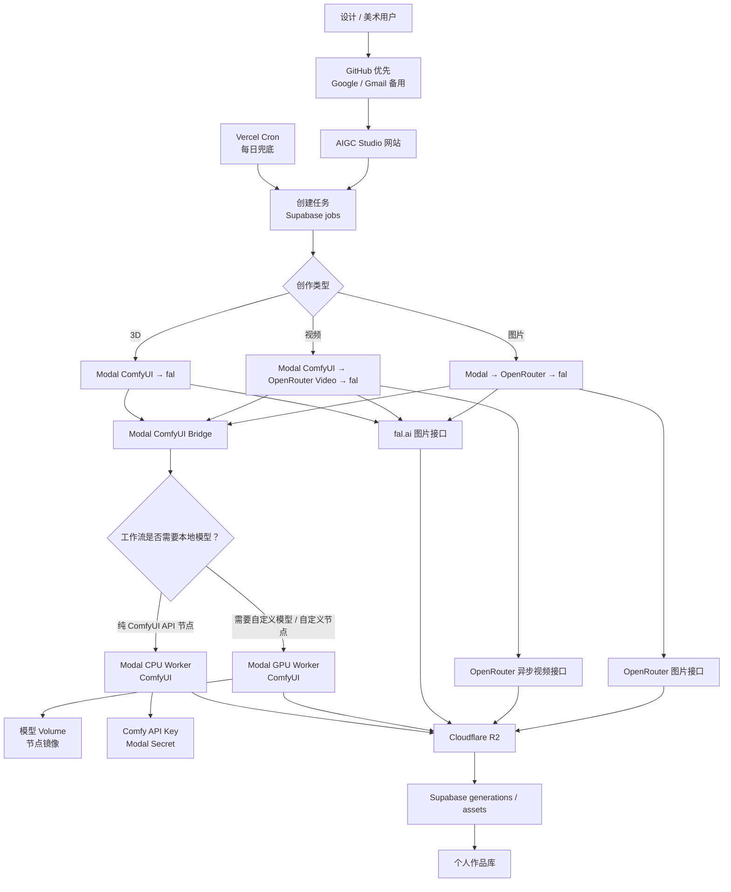
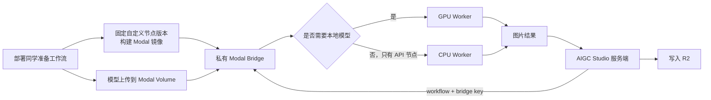

# AIGC Studio 后端流程：Modal ComfyUI 优先

这份说明确定图片后端的优先顺序和职责。它面向部署 / 开发同学；普通设计和美术使用者不需要看见这些服务名称。

## 一、最终优先顺序

1. **Modal + ComfyUI**：主路径。
   - 自定义模型、自定义节点、需要本地模型采样的工作流，运行在 **Modal GPU**。
   - 只使用 ComfyUI 付费 API 节点、没有本地模型的工作流，运行在 **Modal CPU**；费用从 ComfyUI API 积分扣除，不占 GPU。
2. **OpenRouter**：图片和视频的第二选择。视频使用它的异步视频接口，提交后要轮询结果。
3. **fal.ai**：图片和视频的第三选择，也是 3D 的第二选择。

OpenRouter 目前有正式的图片和视频生成接口，但没有可作为本项目依赖的、正式 3D 模型生成接口。因此 3D 不应把 OpenRouter 写成可用后端。

这里的“优先”是部署和默认选择顺序，**不是静默自动换服务**。某个服务配置错误或额度不足时，网站应清楚报错，不应把用户任务偷偷换到另一个付费服务。

## 二、整体流程图

## 三、Modal 内部流程

模型和自定义节点的同步属于**部署阶段**：工作流或模型版本变更时，部署同学构建镜像、同步 Volume、做节点兼容检查。它不应在每位美术同学每次点击生成时执行，否则会造成排队、费用和版本不可控。

## 四、参考项目与本项目的对接结论

参考 [comfyui_modal_bridge](https://github.com/lynclee/comfyui_modal_bridge) 的关键做法适合本项目：

- 用私有 Bridge key 保护 Modal endpoint；
- 自定义节点进入镜像，模型进入 Modal Volume；
- 纯 API 工作流走 CPU，模型工作流走 GPU；
- GPU / CPU worker 都可以闲置归零；
- API key 存在 Modal Secret，由云端 ComfyUI 在 `/prompt` 的 `extra_data.api_key_comfy_org` 使用。

但它原本是 **ComfyUI Desktop 插件**：会从用户本机同步节点和模型、并把结果回填本地画板。网站后端不能直接把这套“读取某台设计电脑”的同步过程照搬进生产；网站应采用部署同学维护的、版本固定的节点清单和模型 Volume。

### 参考 Bridge 的请求约定

该参考实现的 Modal endpoint 大致是：

| 动作 | 请求 | 鉴权 |
|---|---|---|
| 提交 | `POST <base>-run.modal.run`，含 `workflow`、`images`、`auth_key`、`needs_gpu`、`gpu_class` | body 的 `auth_key` |
| 查状态 | `GET <base>-status.modal.run?job_id=...&key=...` | query 的 `key` |
| 取消 | `POST <base>-cancel.modal.run`，含 `job_id`、`auth_key` | body 的 `auth_key` |

完成状态可能带小文件的 base64 数据，而不一定是公网 URL。网站服务端必须把这些数据安全写入 R2，不能直接把它们交给浏览器。

## 五、当前仓库确认结果（2026-07-11）

| 项目 | 现状 | 结论 |
|---|---|---|
| 图片服务默认顺序 | 代码默认是 `modal`，其次 `openrouter`、`fal` | 符合主顺序 |
| Modal 工作流 | 已把两份 ComfyUI API JSON 发送给现有 Modal endpoint | 只覆盖“已有自定义 Modal 服务”的简单协议 |
| 自定义节点 / 模型同步 | 当前网站没有部署或同步逻辑 | 尚未接入参考 Bridge 的部署能力 |
| Modal GPU / CPU 分流 | 当前网站不会为纯 API 工作流显式发送 `needs_gpu=false` | 尚未完整接入 |
| ComfyUI API key | 现有“直连 ComfyUI”模式可在服务端传入 key | 与目标的“Modal CPU Worker + Modal Secret”不是同一条路径 |
| OpenRouter 图片 | 已有任务、状态同步和 R2 保存 | 可作为第二选择 |
| OpenRouter 视频 | OpenRouter 官方已有异步视频 API，但本项目尚未接 adapter | 应排在 fal 视频之前，待实现 |
| OpenRouter 3D | 没有可依赖的正式 3D 生成 API | 不纳入 3D 路由 |
| fal | 已有图片、3D、视频任务、状态同步和 R2 保存 | 图片 / 视频第三选择，3D 第二选择 |

因此，**当前后端不能宣称已完整满足“Modal GPU 自定义模型 + Modal CPU Comfy API 工作流”的目标**。它具备 jobs、状态轮询、R2 保存和多 provider 的外壳；还需要把 Modal adapter 改成 Bridge 协议，并部署一套受版本管理的 Bridge。

## 六、实现完成的验收条件

1. `AIGC_IMAGE_PROVIDER=modal` 时只使用 Modal Bridge，不再把直连 ComfyUI 当作普通用户路径。
2. 自定义模型工作流能在 GPU worker 成功执行，并从固定 Volume 读取模型。
3. 提供一份真实导出的纯 ComfyUI API 工作流 JSON 后，服务端能识别它为 CPU 路径；Comfy API key 只存在 Modal Secret。
4. Bridge 小文件 base64 结果和任何可下载结果都由服务端写入 R2，完成后才进入个人作品库。
5. Bridge key、Modal token、Comfy API key 永不进入浏览器、git、截图或任务响应。
6. OpenRouter 图片、OpenRouter 视频、fal 仍能单独被部署同学切换使用；旧任务继续按记录中的 provider 查状态。

## 七、下一步需要的输入

要实际接通 CPU 路径，需要部署同学提供一份从 ComfyUI 导出的、确实包含付费 API 节点的 **API 格式 workflow JSON**。没有这个 JSON，不应该凭空编造节点名称或输入字段；否则网页能提交但云端 ComfyUI 会在执行时失败。
