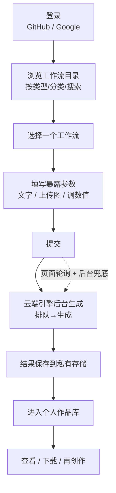
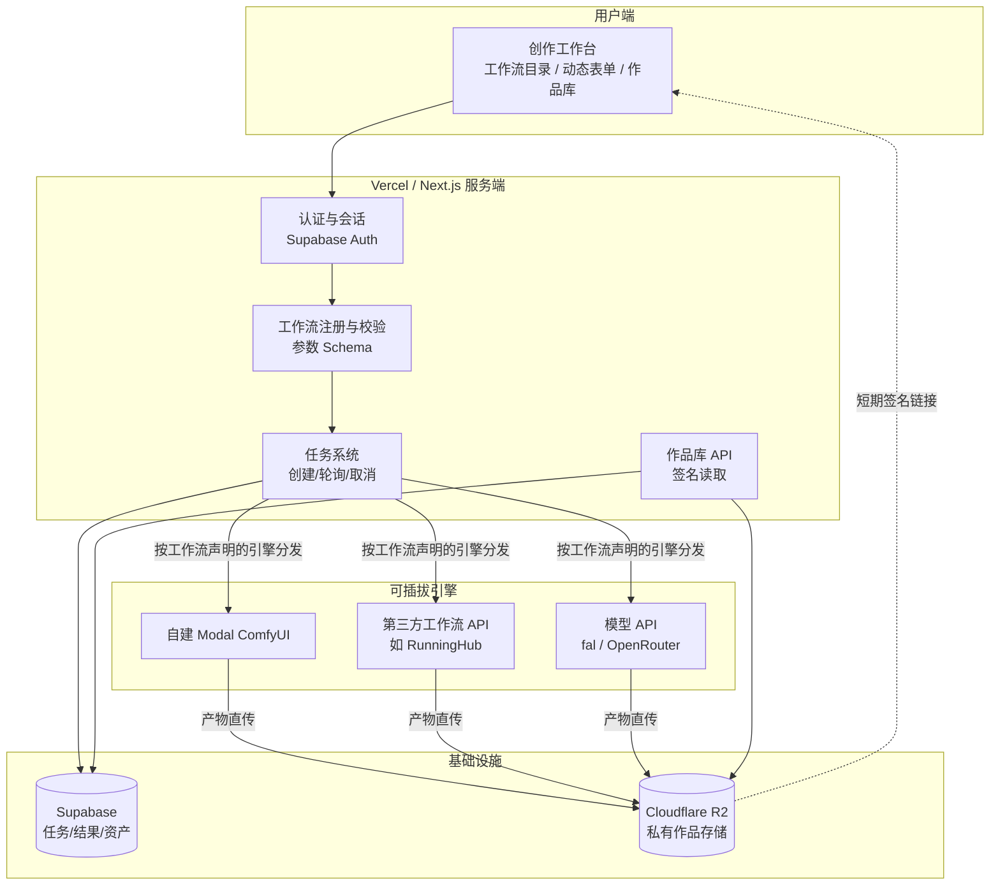

# AIGC Studio 平台总览

> 本文面向想快速了解本项目的人:产品 / 设计 / 美术 / 研发 / 合作方。
> 从大到小:先讲我们要做什么、为谁做,再讲怎么用、怎么搭、分几步走。
> 状态:2026-07 定稿的顶层愿景与架构基准。具体实现细节以 `docs/HANDOFF.md` 和各架构 brief 为准。

---

## 1. 一句话定位

**AIGC Studio 是一个多功能 AI 创作平台:让不懂 AI 工具链的创作者,像用美颜相机一样,直接使用上百个专业级生成工作流——生图、生视频、生 3D,文生图、图生图,一处登录、一处出片、一处收藏。**

---

## 2. 愿景

把散落在 ComfyUI、各类模型 API、专业工具链里的生成能力,收敛成一个**统一、易用、可持续扩张**的创作平台:

- 对**使用者**:不装环境、不配节点、不碰密钥,选一个工作流、填几个参数,云端出片,作品自动进个人库。
- 对**创作者 / 平台方**:把一条调好的生成流程一次性沉淀为"工作流",发布后人人可用;能力以**数据**方式无限累积,而不是靠不断堆代码。
- 对**平台**:后端算力和模型可插拔、可替换、可混用;今天用别人的 API 冷启动,明天用自建算力沉淀核心能力,同一套产品外壳不变。

一句话概括愿景:**创作能力平台化——让每一条好流程都能被沉淀、被复用、被规模化。**

---

## 3. 我们要解决的问题

### 3.1 现状痛点

| 角色 | 今天的痛点 |
|---|---|
| 美术 / 设计 | 想用 AI 出图/出片,但 ComfyUI 要装环境、配节点、调参数,门槛高;换个效果就得换整套工程 |
| 团队 / 工作室 | 好的生成流程锁在某个人的电脑里,无法沉淀、无法共享、无法交付给不懂技术的同事 |
| 平台方 | 每加一个新玩法都要改代码、发版;能力无法快速堆量 |

### 3.2 目标用户

- **主要**:设计师、美术、内容创作者——只想要结果,不想碰底层。
- **次要**:美术 TD / 高级用户——愿意设计工作流,并分享给团队。
- **潜在**:通过 API 把生成能力接进自己系统的开发者。

---

## 4. 产品形态:一个多模态创作平台

平台按"输入模态 × 输出模态"覆盖主流生成场景,工作流数量可增长到**上百个**:

| 输出 \ 输入 | 文本 | 图片 | 文本+图片 | 多图 |
|---|---|---|---|---|
| **图片** | 文生图 | 图生图 / 放大 / 重绘 | 局部重绘 / 参考生成 | 多图融合 |
| **视频** | 文生视频 | 图生视频 | 首尾帧 / 参考视频 | — |
| **3D** | 文生 3D | 图生 3D | — | 多视图生 3D |

每一个格子里可以有**多个工作流**(不同模型、不同风格、不同质量档),这就是"上百工作流"的来源。用户看到的不是"模型选择器",而是一个个**取好名字、配好参数的工作流卡片**。

---

## 5. 核心设计理念

平台和普通工具的分水岭,就在这五条原则上:

1. **工作流即数据,不是代码。** 加一个新玩法 = 加一条工作流数据,不改代码、不发版。这是平台能扩张到上百工作流的前提。
2. **双层抽象:生产层与消费层分离。** 创作者在"生产层"编排复杂流程并声明对外暴露哪几个参数;普通用户在"消费层"只看到简单表单。同一条 ComfyUI 图,专家编排、小白使用。
3. **用户零门槛、零密钥。** 普通用户永远看不到底层工具、模型、服务商和任何密钥;全程只在网页交互。
4. **引擎可插拔。** 后端算力(自建 ComfyUI / 第三方工作流 API / 各类模型 API)通过统一引擎接口接入,由工作流自己声明用哪个引擎,可混用、可替换。
5. **为规模化预留结构,但从垂直切片长出来。** 数据模型一开始就为"上百工作流 + 用户创作 + 多引擎"留好位置;但能力用少量真实工作流驱动、跑通再铺量,不做空中楼阁。

---

## 6. 核心概念(术语表)

| 概念 | 含义 |
|---|---|
| **工作流 Workflow** | 一条完整的生成流程定义(如"文生图-写实风")。包含:输出类型、使用的引擎、底层流程定义(ComfyUI 图 / API 参数)、以及**对用户暴露的参数**。平台的基本单元 |
| **参数 Schema(Input Schema)** | 工作流声明"用户需要填什么":文本、图片、数值、选项等。前端据此渲染表单,后端据此校验,并把用户输入注入底层流程 |
| **引擎 Engine** | 真正执行生成的后端:自建 Modal ComfyUI、第三方工作流 API(如 RunningHub)、模型 API(fal / OpenRouter)等。工作流声明自己走哪个引擎 |
| **任务 Job** | 用户一次提交产生一条任务,有完整生命周期:排队 → 生成 → 完成 / 失败 / 取消 |
| **作品 / 资产 Asset** | 任务成功后产出的文件(图 / 视频 / 3D 模型),保存在私有云存储,归属到用户 |
| **个人作品库 Library** | 用户所有成功作品的集合,按类型展示、可下载 |

---

## 7. 用户交互流程

### 7.1 主流程



### 7.2 分步说明

1. **登录**:GitHub 优先,Google / Gmail 备用(Supabase Auth 托管)。登录后进入创作工作台。
2. **选工作流**:从工作流目录里挑一个(如"图生视频-电影感")。目录支持按输出类型、分类、搜索浏览。
3. **填参数**:界面根据工作流的参数 Schema 动态渲染——纯文字的只给输入框,图生图的给上传位 + 强度滑杆,以此类推。用户不接触任何节点或模型概念。
4. **提交**:创建任务,平台把用户输入注入底层流程,交给对应引擎。
5. **生成**:引擎在云端 GPU/CPU 上执行。页面实时轮询任务状态;用户关掉页面后,后台定时任务兜底检查。
6. **完成**:产物落私有存储、写入作品库。只有存储成功才算完成。
7. **查看**:作品进个人库,按类型展示,可下载,后续可作为新任务的输入(如把生成的图再拿去生视频)。

### 7.3 各模态的差异

差异**只体现在参数 Schema 和引擎**,主流程完全一致——这正是平台化的价值:

| 模态 | 用户额外要填 | 典型引擎 |
|---|---|---|
| 文生图 | 仅文字 | ComfyUI / 模型 API |
| 图生图 | 文字 + 参考图 + 强度 | ComfyUI |
| 文生视频 | 文字(+ 时长/比例) | ComfyUI / 视频 API |
| 图生 3D | 一张或多张图 | ComfyUI / 3D API |

---

## 8. 工作流从哪来:谁设计?

参考成熟平台(如 RunningHub)的做法,答案是**分层 + 分阶段**,不是"平台定死"或"用户全包"的二选一。

### 8.1 双层模式

- **生产层**(创作者 / 平台方):设计 ComfyUI 工作流,发布时声明对外暴露哪些参数。
- **消费层**(普通用户):只用发布好的工作流,填暴露参数。

### 8.2 分阶段开放

| 阶段 | 工作流由谁产出 | 说明 |
|---|---|---|
| **Phase 1(起步)** | 平台 / 管理员策展 | 我们把调好的工作流注册进平台、手工声明参数。质量可控、门槛最低 |
| **Phase 2(成长)** | 受信创作者上传 | 内部美术 TD / 高级用户上传自己的工作流,声明暴露参数、发布给团队。受控 UGC |
| **Phase 3(生态)** | 开放 UGC + 社区 | 工作流市场、在线编辑、分享甚至变现。远期,工程量大 |

关键:**三个阶段共用同一套数据模型**,后续是"能力开放",不是推倒重来。数据结构从第一天就为 Phase 2/3 留好字段(作者、可见范围、状态、参数到节点的绑定)。

---

## 9. 系统架构

### 9.1 分层视图



### 9.2 各层职责

| 层 | 职责 |
|---|---|
| **用户端** | 工作流目录浏览、按 Schema 动态渲染参数表单、任务状态、作品库。不含任何密钥或底层概念 |
| **服务端** | 身份与归属、工作流白名单与参数校验、任务生命周期、按工作流声明的引擎分发、作品库签名读取 |
| **引擎层** | 统一接口(提交 / 查状态 / 取消 / 取回产物),下面可接自建算力或任意第三方。工作流决定走哪个 |
| **基础设施** | Supabase 存任务与归属;Cloudflare R2 私有存作品,浏览器只拿短期签名链接 |

---

## 10. 关键数据模型

平台可扩展性的核心在这几张结构里:

```text
Workflow(平台基本单元)
  id / slug / 标题 / 分类
  输出类型(image | video | model3d | ...)
  引擎(comfyui-modal | runninghub | fal | ...)
  参数 Schema  ── 用户要填什么 + 每个参数绑定到底层流程的哪个位置
  底层定义     ── ComfyUI 图 / API 参数模板
  作者 / 可见范围 / 状态 / 版本   ← 为 UGC 阶段预留

Job(一次提交)
  归属用户 / 工作流 / 状态 / 引擎任务号 / 请求参数

Generation(一次成功结果) → Asset(实际文件:R2 key / 类型 / 尺寸)
```

设计要点:

- **参数绑定**(参数 → 底层流程某个节点/字段)是平台的关键机制:有了它,"渲染表单 + 注入流程"完全数据驱动,加工作流不改代码;Phase 1 我们手工填,Phase 2 创作者自己挑,机制不变。
- **归属只认登录会话**:所有任务、作品、下载都按登录用户 ID 限定,不信任浏览器传入的身份。
- **完成即入库**:只有产物成功存进私有 R2 才算完成,不把临时链接当作品。

---

## 11. 技术选型与现状

### 11.1 技术栈

| 环节 | 选型 |
|---|---|
| 前端 / 服务端 | Next.js(App Router),部署在 Vercel |
| 认证 | Supabase Auth(GitHub / Google OAuth) |
| 数据库 | Supabase(Postgres) |
| 作品存储 | Cloudflare R2(私有,S3 兼容) |
| 生成引擎 | 自建 Modal + ComfyUI / 第三方工作流 API / fal / OpenRouter |
| 定时兜底 | Vercel Cron |

### 11.2 现状(诚实分层)

| 层 | 状态 |
|---|---|
| 已实现 | 三入口工作台、任务生命周期(排队/生成/完成/取消,含并发保护)、四类图片引擎适配、R2 存储与安全校验、GitHub/Google 登录 |
| 设计中(未落代码) | 工作流数据化 / 参数 Schema 平台化、自建 Modal ComfyUI 直传 R2、引擎按工作流分发 |
| 待验证 | 尚未配置线上环境变量,**任一引擎的真实端到端生成还未跑通一次**;上线联调是紧接着的重点 |

> 重要:当前"代码完成度"不等于"平台已上线"。下一步的核心是先把一条最短链路真正跑通。

---

## 12. 引擎策略:自建 vs 接入

平台不绑定单一后端。三条路线靠统一引擎接口并存:

| 路线 | 拿到能力的方式 | 取舍 |
|---|---|---|
| **接入第三方(Buy)** | 直接调第三方工作流 API(如 RunningHub),快速获得海量工作流 | 上手快、成本按量、可控性低 |
| **自建(Build)** | 自建 Modal + ComfyUI,完全可控 | 可控/可沉淀,工程较重 |
| **混合(推荐)** | 先接第三方冷启动、验证平台形态,同时自建做核心与独家工作流 | 兼顾速度与沉淀 |

因为工作流自己声明引擎,三条路线可同时存在、逐步迁移,不影响产品外壳。

---

## 13. 分阶段路线图

```text
Stage 0  垂直切片跑绿:登录 → 1 个真实工作流 → 出片 → 存储 → 作品库
         (先证明整条链路是活的)
Stage 1  平台地基:工作流数据化 + 参数 Schema + 引擎按工作流分发
         用「文生图 / 图生图 / 文生视频」三个真实工作流验证抽象
Stage 2  引擎规模化:自建 ComfyUI 直传存储 和/或 接入第三方工作流 API
         → 从此每加一个工作流 = 加一条数据
Stage 3  平台化体验:工作流目录(分类/搜索)、动态表单、作品库筛选、再创作
Stage 4  运营与开放:工作流上下架/版本/可见范围;受信创作者上传;(远期)UGC 生态
```

原则:**先垂直跑通、再水平铺量;抽象从真实工作流长出来,不凭空设计。**

---

## 14. 安全与边界

1. 普通用户永远看不到底层工具、模型、服务商和任何密钥。
2. 所有任务、作品、下载严格按登录用户归属,不信任浏览器传入身份。
3. 服务端密钥(数据库、存储、各引擎、定时任务)只在服务端,绝不进浏览器。
4. 作品存储私有,浏览器只拿短期签名链接。
5. 产物必须成功入库才算完成;不把临时链接当作品。
6. 引擎切换不静默跨服务商扣费;失败要明确失败。

---

## 15. 待拍板事项

以下决策会影响下一步落地方向:

1. **起步阶段工作流由谁产出**:确认 Phase 1 先由平台 / 管理员策展?
2. **引擎路线**:先接第三方工作流 API 快速验证形态(混合),还是坚持先自建?
3. **面向人群边界**:主要服务内部团队,还是面向更开放的用户?(影响登录方式、可见范围、分享逻辑)

---

## 附:与参考平台的关系

RunningHub 等成熟平台验证了本设计的关键选择:**工作流即数据、双层抽象(创作者编排 / 用户填参)、官方+UGC 并存、工作流以 API 方式执行**。本平台在此基础上,按"先给团队交付、再逐步开放"的节奏推进,并保持引擎可插拔,以便在自建与接入之间灵活取舍。
